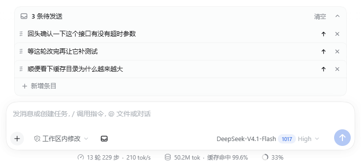

# dsh-staging-list

给 DeepSeek Harness 的输入框加一个**待发送列表**：把还没想好怎么发、或不打算立刻发的内容先攒起来，等到合适的时机逐条发出去。

*[English summary ↓](#english)*

## 为什么要做这个

等 agent 干活的时候，脑子里经常会冒出新的问题或需求。它们大多没法直接塞进当前对话：

- 有的和当前任务无关，直接发会污染上下文，agent 也容易把两件事混着做；
- 有的应该等当前任务收尾之后再提，提前发只会变成排队里的噪音；
- 手动先记到别处（备忘录、临时文件），回头还要复制粘贴，顺手写的格式、上下文线索全丢了。

这个插件就是给这些「暂时不该发」的输入一个落点：按会话隔离的一份列表，写完先扔进去，等当前任务告一段落，点一下发送。



## 功能

- **一键暂存**：输入框工具行左侧的托盘按钮，把当前草稿移出输入框、变成列表里的一条；草稿为空时则新建一条空条目。
- **面板**：位于输入框上方，显示待发条数，可折叠；列表末尾有「新增条目」。
- **就地编辑**：点条目文字直接改；`Esc` 取消，`Ctrl/Cmd + Enter` 保存，失焦自动保存。
- **逐条发送**：每条都有自己的发送按钮，编辑时也不会消失。
- **排序**：拖拽左侧手柄。**删除**：每条右侧的叉号。**清空**：表头的「清空」，点一次变红成「确认清空」，再点一次才真的清空。
- **按会话隔离**：切换会话看到的是各自的列表；刷新页面、重启应用都还在。

## 安装

前置：带 Web 界面的 DeepSeek Harness（桌面版窗口、或用 `dsh web` 启动的浏览器版都可以）。

**方式一：本地目录**（最稳）

1. 把仓库克隆到本机任意位置；
2. 打开侧边栏的「插件」面板 → **安装第三方插件**，填入克隆下来的文件夹路径；
3. 安装完成后刷新页面。

**方式二：GitHub 地址**

1. 打开侧边栏的「插件」面板 → **安装第三方插件**，填入仓库地址：
   ```
   https://github.com/ixtWuko/dsh-staging-list
   ```
2. 安装完成后刷新页面。

这种方式要求本机能直接访问 GitHub（走直连，不经过 npm 安装源），网络受限时用方式一。

也可以用 agent 装（等价操作）：让 agent 执行 `plugin_manager install_bundle`，`target` 指向仓库目录。

**卸载与更新**都在「插件」面板里完成：更新需要先卸载再装新版本。

## 使用

**输入框工具行（左下）**

- 托盘按钮：把输入框里的内容移入暂存区。输入框为空时，它变成「新增条目」。

**暂存面板（输入框上方）**

- 表头：`3 条待发送`、`清空`、折叠箭头。清空要点两次——第一次变红成「确认清空」，第二次才真的清。
- 条目行：左侧拖拽手柄，中间文字预览，右侧常驻发送与删除（叉号）；进入编辑时这两个按钮也不会隐藏。
- 末行「＋ 新增条目」：在列表末尾插入一条空条目并直接进入编辑。

**编辑一条**

- 点文字就地编辑；`Esc` 取消，`Ctrl/Cmd + Enter` 或失焦保存。
- 编辑中点发送：先保存正在编辑的内容，再把这一条发出去。

## 行为与边界

- 发送走的是输入框同一条链路（`session.prompt`，投递模式 `queue`）：会话空闲时直接进对话；正在跑任务时排到下一轮，和你在输入框里按发送的行为一致。
- 只支持纯文本：没有附件；`@文件` 引用不会展开成芯片；`/命令` 会当普通文本发出去。
- 没有乐观回显：消息要等会话事件回流后才出现在对话里（条目本身是立刻消失的）。
- 数据只存在当前浏览器（`localStorage`，键 `dsh.staging-list.v1`）：换设备、换浏览器看不到；清除站点数据会丢。会话归档后就不再出现在侧边栏，但本地数据还在，取消归档后会重新出现。
- 界面文案中英双语，跟随 Harness 的语言设置；配色跟随主题（浅色/深色）。

## 和其他东西的区别

| 方式 | 内容状态 | 放在哪 |
|---|---|---|
| **暂存区**（本插件） | 还没发出去 | 输入框上方的面板，按会话隔离 |
| **队列**（内置 QueueDock） | 已经发出、等下一轮 | 输入框上方，由会话 inbox 驱动 |
| **新开会话** | 独立上下文 | 侧边栏 |

## 实现

没有 Host 侧逻辑，全部在客户端：

- 两个扩展位：`conversation.input.left`（工具行按钮）和 `conversation.input.dock`（面板）；
- 发送复用 `ctx.remote.session.prompt`，不另造投递通道；
- 列表状态存在浏览器 `localStorage`，不写会话日志，只有发送时才产生 Host 侧事件。

## 开发

没有构建步骤：`client.js` 就是最终产物，改完刷新页面即可（只有在 DSH 源码仓库里跑着 `pnpm run dev:web` 时，客户端插件才会热更新）。

```
node test/smoke.mjs
```

冒烟测试用 React 桩件在 Node 里跑 `client.js`，覆盖：模块注册、两个 slot 的注册顺序、空列表不渲染、行/操作/末尾新增行、发送时传给 `session.prompt` 的参数、发送成功后条目移除、删除后记录清理。

改代码前值得知道的两件事：

- **文案有两处**：`locale/*.json` 只放插件列表里的标题和描述（Host 在插件未激活时读它）；界面文案在 `client.js` 的 `DICT` 里，通过 Client locale 服务注册，跟随语言切换。
- **包名带作者 scope**：`@ixtwuko/dsh-staging-list`，以本地目录方式安装，不发布到 npm。

## 兼容性

针对 DeepSeek Harness `0.2.1-rc.5` 的 Web 界面开发。用到的 slot、locale、Remote 都是插件可用的公开接口，但 Harness 版本升级后仍可能变化；升级后如果按钮消失或发送报错，先对一下版本。

## English

A staging list for the DeepSeek Harness composer.

While an agent works, follow-up questions and tasks pile up: some are unrelated to the running conversation, others should wait until it finishes. This plugin parks them above the input as a per-session list, so nothing gets mixed into the current context by accident.

- **Stage** — the tray button in the composer tool row moves the draft into the list, or adds an empty item when the draft is empty.
- **Work on it** — edit in place, drag to reorder, delete single items, clear the list.
- **Send** — one item at a time, through the same `session.prompt` path the composer uses: straight into the conversation when idle, queued behind the current turn while the agent is running.

Text only, no attachments. Items live in this browser (`localStorage`), per session, and survive reloads. Requires DeepSeek Harness with the Web GUI (built against `0.2.1-rc.5`).

Install: open **Plugins** in the sidebar → **Install a third-party plugin**, then paste this repository URL or a local checkout path.

## License

MIT — see [LICENSE](LICENSE).
